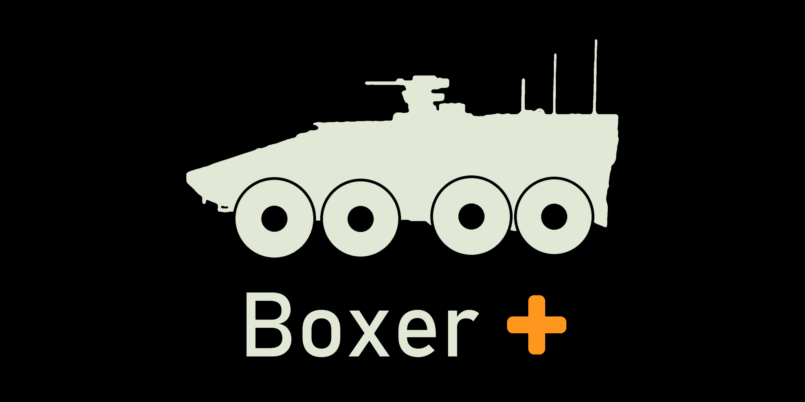

# Boxer +

    

    
    
    
     
    
    

__Requires__ [GTK Boxer](https://steamcommunity.com/sharedfiles/filedetails/?id=3780478952), [BWMod (BWA3)](https://steamcommunity.com/sharedfiles/filedetails/?id=1200127537), [CBA_A3](https://github.com/CBATeam/CBA_A3) and [ACE3](https://github.com/acemod/ACE3).

__Boxer +__ (BXP) is a patch for the workshop mod [GTK Boxer](https://steamcommunity.com/sharedfiles/filedetails/?id=3780478952) by Hawkeye that brings BWA3 content onto the Boxer.

The project is entirely __open-source__ and any contributions are welcome.

Steam Workshop: <https://steamcommunity.com/sharedfiles/filedetails/?id=3819297677>  
Discord: <https://discord.gg/ag4v6kxYAa>  

## Features

- **Spike LR:** replaces the Titan AT missile on `Hawks_GTK_Boxer_IFV` (and its Sand / Snow / AUS variants) with BWA3's MELLS Spike LR (`bwa3_land_spikeLR_atgm`, magazine `bwa3_mells_spikeLR_2rnd_puma`): TV camera after launch, mouse-aimed in flight, lofted flight profile. Loadout stays 2 + 2.
- **Crews:** Woodland / Winter use `BWA3_Crew_Fleck`, Sand uses `BWA3_Crew_Tropen`, the Medical uses `BWA3_Medic_Fleck` / `BWA3_Medic_Tropen`. AUS keeps the vanilla `B_crew_F`.
- **Rear view:** ACE viewports framework. Passengers look at the ramp to see the Boxer's reverse camera. On the Medical only the commander and medic seats get it; not on the RCH155. Proof of concept.
- **Puma inventory:** the HMG, GMG, IFV and RCH155 carry the BWA3 Puma's cargo (G36 and MG4 ammo, DM25 / DM32 grenades, G36 and MG4 with pointer, 2 PzF 3 Tandem, first aid kits). Not on the Medical or the AUS variants.
- `Hawks_fnc_spikeLoop` is overridden: same flap / fire-lock logic, watching the BWA3 weapon.

Missile guidance goes through ACE, so ACE3 has to be loaded. The crew class is one per vehicle, so every seat gets the same BWA3 unit. The mod does nothing on its own.

## Building

`hemtt build` (or `hemtt dev`). Release: `hemtt release` (zips land in `releases/`).

## Contributing

For new contributors, see the [Contributing Setup & Guidelines](./.github/CONTRIBUTING.md).

## License

Boxer + is licensed under [MIT](./LICENSE).
